## operaciones basicas con open cv 
# Iker Montoya NC 0105
## imagen curso open cv 
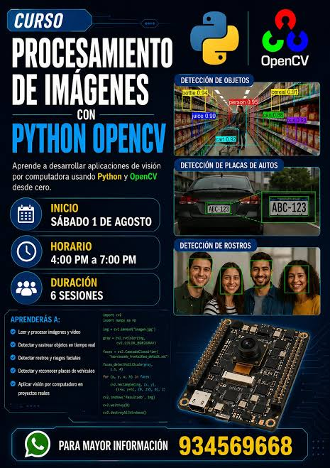

# imagen original 
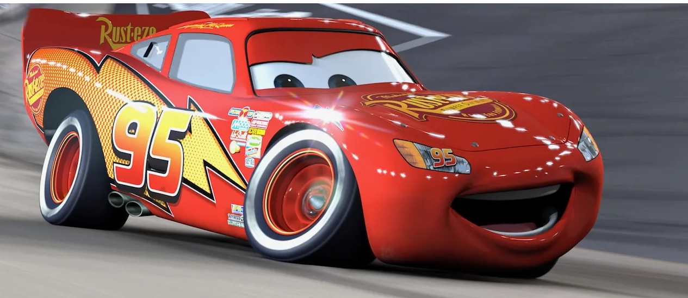

# imagen circulo azul
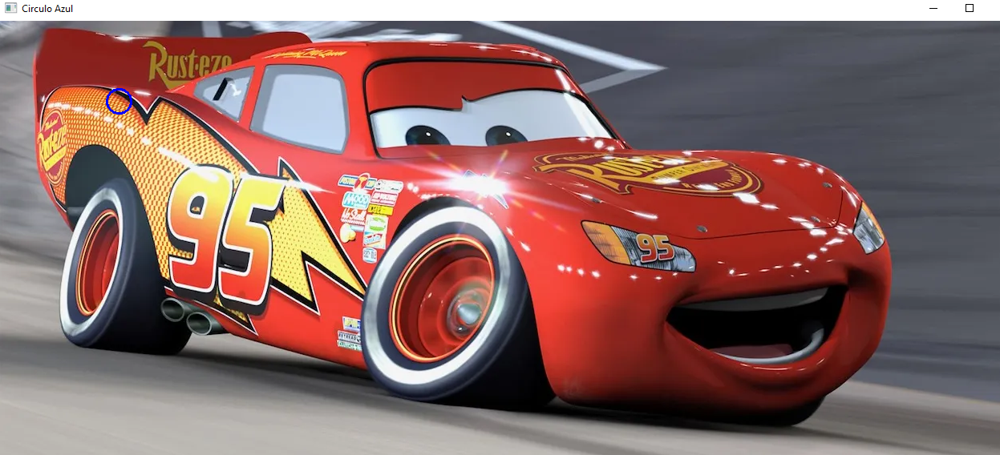

# imagwn con roi marcado 
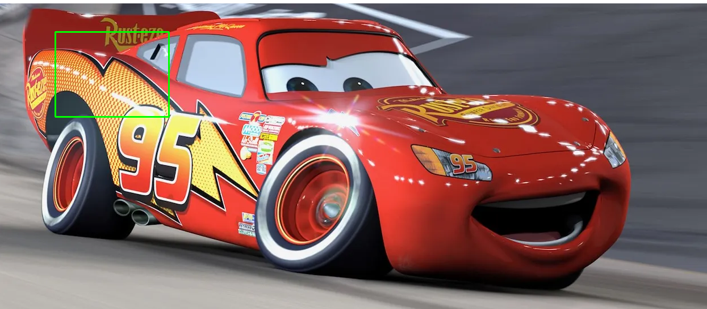

# imagen con roi recortada 
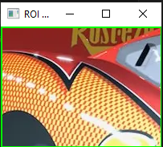

# imagen escala de grises 
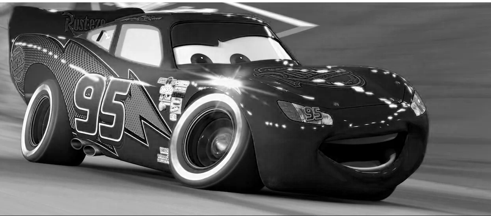

# canal rojo escala de grises 
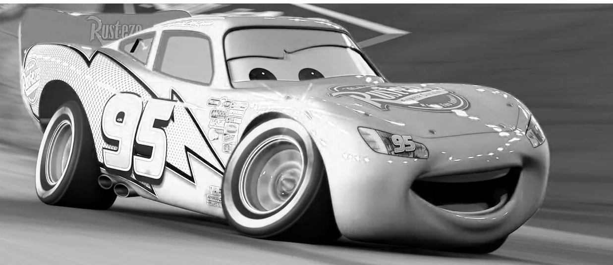

# imagen canal azul rojo y verde coloreado 
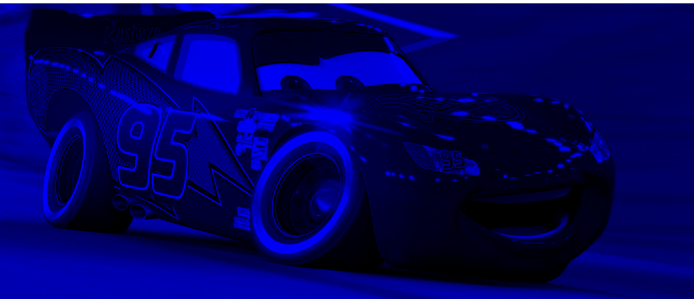
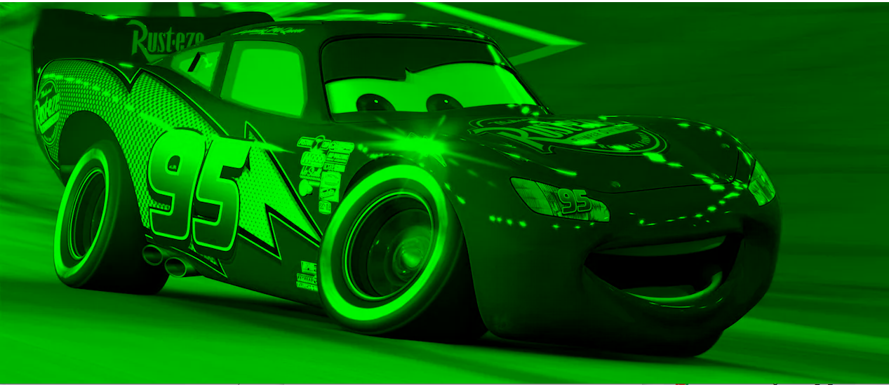
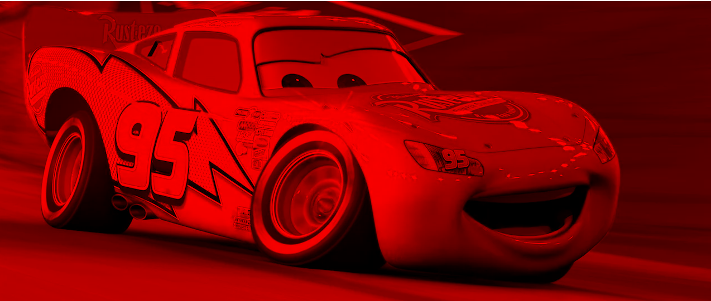

# imagen redimensionada 400x300
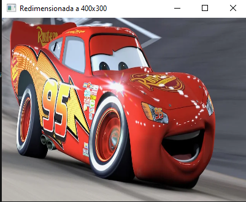

# imagen mitad de tamaño 
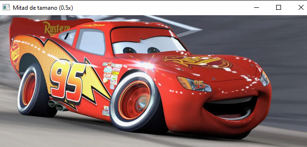

# imagen 45 grados 
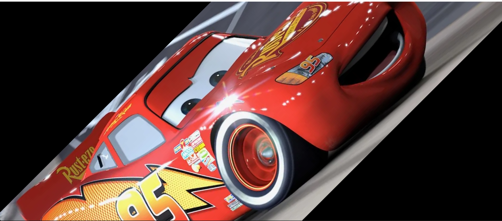

# imagen espejo 
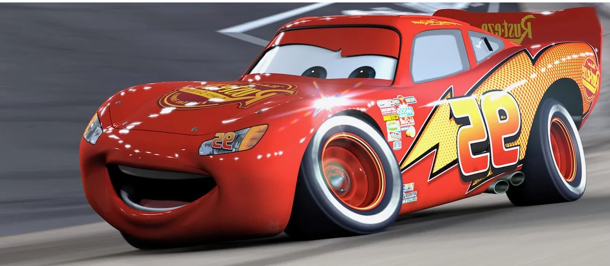

# iamgen volteo vertical 
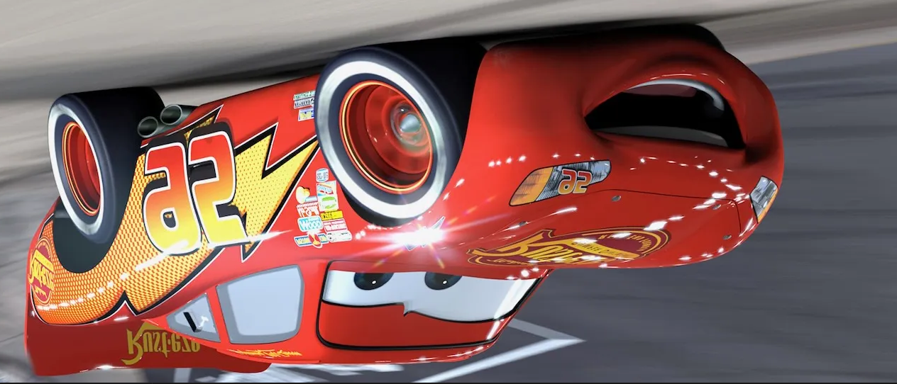

## imagen volteo en ambos eje 
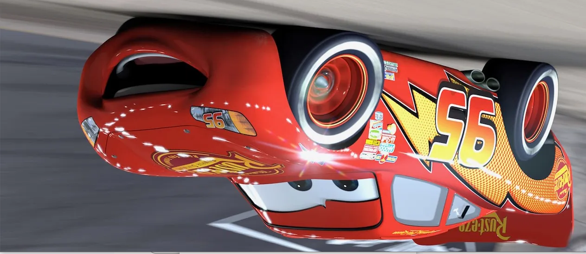